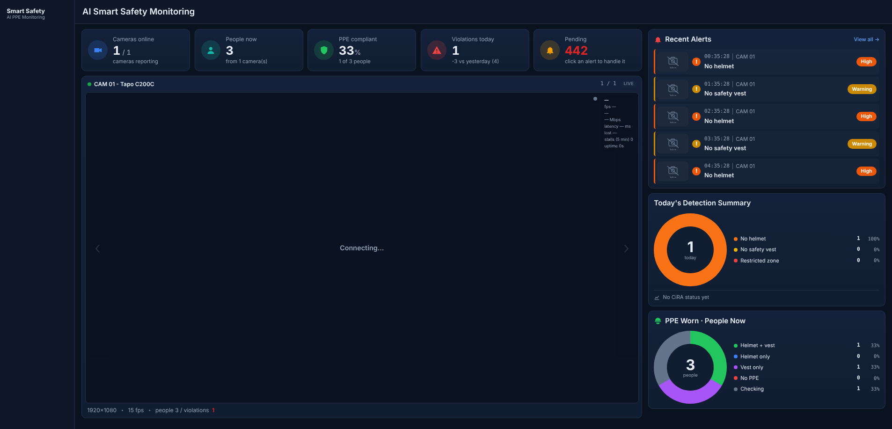
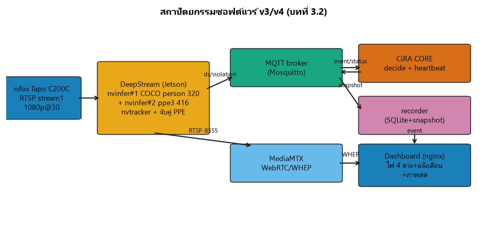

# PPE Vision-Based PPE Monitoring

> **AI Smart Safety Monitoring for Factory Workers.** Real-time helmet and hi-vis vest (PPE) monitoring on a Jetson Nano 4GB: DeepStream 6.0.1 + YOLOv8n TensorRT for perception, CiRA CORE for the decision layer, and a web dashboard with WebRTC live video, alerts with snapshots and event history.

ระบบต้นแบบตรวจจับการไม่สวมหมวกนิรภัยและเสื้อสะท้อนแสงจากกล้อง IP แบบเรียลไทม์บน Jetson Nano แล้วแจ้งเตือนผ่าน Dashboard บนเว็บ พร้อมภาพสด รูปเหตุการณ์ และประวัติให้เจ้าหน้าที่กดยืนยัน ระบบเป็นตัวช่วยเฝ้าระวัง ไม่ได้แทนมาตรการความปลอดภัยหรือการตรวจโดยผู้รับผิดชอบ



## ภาพรวมระบบ



1. **Perception** (`perception/`): DeepStream 6.0.1 บน Jetson Nano ดึงภาพ RTSP จากกล้อง Tapo C200C (1920×1080 @ 30 fps) ตรวจคนด้วย YOLOv8n COCO 320×192 และตรวจหมวก/เสื้อด้วยโมเดล ppe3 416×256 ที่เทรนเอง (TensorRT FP16 ทั้งคู่) แล้วจับคู่ PPE กับแต่ละคน ส่ง `ds/violation` พร้อม snapshot ทาง MQTT และส่งภาพสดออกทาง RTSP
2. **Decision** (`decision/`): flow ใน CiRA CORE รับ `ds/violation` กรองด้วยเกณฑ์ความมั่นใจและ cooldown 30 วินาที แล้วส่ง event (`via: "cira"`) พร้อม heartbeat ทุก 10 วินาที ถ้า CiRA เงียบเกิน 15 วินาที แอป DeepStream ส่ง event เองแบบ fallback
3. **Dashboard** (`dashboard/`): Docker บน Jetson ได้แก่ mosquitto, recorder (FastAPI + SQLite), MediaMTX (แปลง RTSP เป็น WebRTC) และ nginx ที่พอร์ต 8080 เสิร์ฟเว็บ 5 หน้า (Overview, Live View, Events, Reports, Settings)

รายละเอียด topic และ payload ทั้งหมดอยู่ใน [`docs/mqtt_spec.md`](docs/mqtt_spec.md)

## โครงสร้าง repo

| โฟลเดอร์ | เนื้อหา |
|---|---|
| [`perception/`](perception/) | แอป DeepStream (`app/person_count_app.py`) + โมดูลจับคู่ PPE, ติดตามคน, ตัดสิน violation, ส่งสถานะ; config ของ nvinfer/tracker; สคริปต์ export โมเดล; unit test |
| [`decision/`](decision/) | flow ของ CiRA CORE (`safety_decision_v1.npj`), โค้ด node JavaScript และ test |
| [`dashboard/`](dashboard/) | เว็บ (HTML/CSS/JS ไม่มี build), recorder (FastAPI + SQLite), nginx, MediaMTX, mosquitto, docker-compose สำหรับ Jetson และ PC |
| [`tools/`](tools/) | ตัวจำลองข้อมูล, สคริปต์ autostart บน Jetson, เครื่องมือ soak test 24 ชม., ตัววัดภาพสด |
| [`training/`](training/) | ข้อมูลการเทรนโมเดล ppe3 (ชุดข้อมูล, hyperparameter, ผลรายรอบ) |
| [`docs/`](docs/) | เอกสารออกแบบ, สเปก MQTT, ข้อเสนอโครงการ และสรุปผลทดสอบทุกครั้ง |
| [`legacy/`](legacy/) | โค้ดรุ่น v1/v2 ที่เลิกใช้แล้ว (ESP32 ไฟ/บัซเซอร์, Dashboard v2, CiRA ตรวจจับเอง) |

## ฮาร์ดแวร์และซอฟต์แวร์

| ส่วน | รายละเอียด |
|---|---|
| บอร์ด | Jetson Nano Developer Kit 4GB, JetPack 4.6.1 (L4T R32.7, Ubuntu 18.04, Python 3.6), โหมด 5W |
| Perception | DeepStream 6.0.1, TensorRT 8.2, CUDA 10.2, pyds 1.1.1, [DeepStream-Yolo](https://github.com/marcoslucianops/DeepStream-Yolo) (commit 2894bab) |
| กล้อง | TP-Link Tapo C200C, RTSP stream1 1920×1080 @ 30 fps H.264 ผ่าน Wi-Fi 2.4 GHz |
| Decision | CiRA CORE Horizon 1.9.4 (Education) |
| Dashboard | Docker: eclipse-mosquitto 2.0.18, MediaMTX 1.9.3, nginx, Python 3.11 (FastAPI); เว็บใช้ mqtt.js 5.10.1 และ Chart.js 4.4.4 |
| เทรนโมเดล | Google Colab (A100), Ultralytics 8.4.177 |

## ผลลัพธ์หลัก (วัดจริง)

| หัวข้อ | ผล |
|---|---|
| โมเดล ppe3 (YOLOv8n, ชุดทดสอบ) | mAP50 0.876, mAP50-95 0.634, P 0.875 / R 0.816 |
| ความเร็วบน Jetson (soak v4) | เฉลี่ย 25.33 fps |
| ความเสถียร 24 ชม. (soak v4) | uptime 100%, แอปรีสตาร์ท 0 ครั้ง, ไม่ throttle, อุณหภูมิสูงสุด 67.0 °C |
| พลังงาน (soak v4) | เฉลี่ย 4,509 mW, 108.15 Wh ต่อ 24 ชม. |
| ภาพสด (soak v4) | live_status ok 1440/1440 นาที |
| การแจ้งเตือน (soak v4) | 26 event ผ่าน CiRA ทั้งหมด (fallback 0), latency มัธยฐาน 220 ms, p95 805 ms |

รายละเอียดและผลทดสอบแต่ละครั้งอยู่ใน [`docs/test-results/`](docs/test-results/) และ [`training/`](training/)

## เริ่มต้นใช้งาน

### ทดลอง Dashboard บน PC (ไม่ต้องมีกล้องหรือ Jetson)

ต้องมี Docker Desktop และ Python 3

```powershell
cd dashboard
docker compose -f docker-compose.dev.yml up -d --build
pip install paho-mqtt pillow
python ..\tools\simulate_v3.py --host localhost --cams 2
```

เปิด http://localhost:8080 (API: http://localhost:8080/api/docs) ดูวิธีจำลองกรณีผิดปกติใน [`dashboard/README.md`](dashboard/README.md)

### ติดตั้งบน Jetson Nano

โค้ดทั้งหมดคาดว่า repo อยู่ที่ `~/safety` ของผู้ใช้ `jetson`

1. ติดตั้ง JetPack 4.6.1 และ DeepStream 6.0.1, clone repo นี้เป็น `~/safety`
2. build DeepStream-Yolo และวางไฟล์โมเดล ONNX ตาม [`perception/README.md`](perception/README.md) (ไฟล์โมเดลไม่อยู่ใน repo; TensorRT engine ต้อง build บน Jetson)
3. สร้าง `~/safety/.cam.env` (`CAM_IP`, `CAM_USER`, `CAM_PASS`) แล้ว `chmod 600`
4. ตั้งค่าและรัน Dashboard ตาม [`dashboard/README.md`](dashboard/README.md)
5. เปิด flow ใน CiRA CORE ตาม [`decision/README.md`](decision/README.md)
6. (ถ้าต้องการ) ตั้ง autostart ตอนบูตด้วย [`tools/safety-autostart.service`](tools/)

### ค่าที่ต้องตั้งเองและไม่อยู่ใน repo

ไฟล์ตัวอย่าง: [`.cam.env.example`](.cam.env.example) และ [`dashboard/.env.example`](dashboard/.env.example)

- รหัสกล้อง: `~/safety/.cam.env` (โค้ดอ่านด้วย `source` เท่านั้น และ log จะแสดงเป็น `rtsp://***@<ip>`)
- PIN สำหรับลบเหตุการณ์: `DELETE_PIN` ใน `dashboard/.env` (ไม่ตั้ง = ปุ่มลบไม่แสดง)
- IP ใน config ถูกแทนด้วยตัวแทน เช่น `<JETSON_TAILSCALE_IP>`, `<JETSON_LAN_IP>` ให้ใส่ค่าของเครื่องตัวเอง โดยเฉพาะ `webrtcAdditionalHosts` ใน `dashboard/mediamtx/mediamtx.yml`
- ไฟล์โมเดล (`*.onnx`, `*.pt`, `*.engine`)

## ข้อจำกัดที่ทราบ

- โมเดลยังพึ่ง pseudo-label ของคน และชุดเทรนไม่มีภาพจากกล้อง Tapo จริง
- RAM ของแอปในรอบ soak v4 แทบคงที่ (0.79 MB/ชม.) แต่รอบนั้นมี event น้อย (26 ครั้ง) จึงยังยืนยันไม่ได้ว่าแก้การรั่วของหน่วยความจำได้
- Virtual Safety Zone รองรับในโค้ดและผ่าน test case แต่ยังไม่ได้ตั้งโซนจริง (event โซน = 0 ทุกรอบ soak)
- ไฟ "Live Video" บน Dashboard อาจแสดงแดงทั้งที่ภาพเล่นปกติ (ยังไม่แก้)
- Dashboard ยังไม่มีระบบ login และ mosquitto ไม่มีรหัสผ่าน ใช้ได้เฉพาะในวง LAN หรือผ่าน VPN (เช่น Tailscale) ห้ามเปิดออกอินเทอร์เน็ตตรง

## ทีม

| สมาชิก | หน้าที่ |
|---|---|
| Puech | ระบบรวม, Jetson และแอป DeepStream, pipeline ภาพสด, การทดสอบและ soak test |
| Mel | ชุดข้อมูลและการเทรนโมเดล |
| Som | flow ตัดสินใจใน CiRA CORE |
| Guy | Dashboard |

## ซอฟต์แวร์และข้อมูลของบุคคลที่สาม

- `dashboard/web/lib/`: mqtt.js 5.10.1 และ Chart.js 4.4.4 (ไฟล์ต้นฉบับ ไม่ได้แก้ไข)
- `perception/export/dsyolo_2894bab/export_yoloV8.py`: คัดลอกจาก [marcoslucianops/DeepStream-Yolo](https://github.com/marcoslucianops/DeepStream-Yolo) commit 2894bab (ดู license ของ repo ต้นทาง)
- การเทรนและ export ใช้ [Ultralytics](https://github.com/ultralytics/ultralytics) YOLOv8/YOLO11 ซึ่งใช้ license AGPL-3.0
- ชุดข้อมูลจาก Roboflow Universe (CC BY 4.0) ดูรายชื่อและที่มาใน [`training/README.md`](training/README.md)
- CiRA CORE เป็นซอฟต์แวร์ของทีมผู้พัฒนา CiRA; repo นี้มีเฉพาะไฟล์ flow ที่ทีมสร้าง
