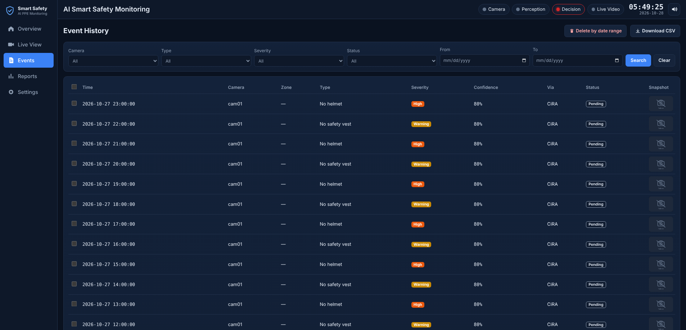

# dashboard: Web Dashboard + recorder

หน้าเว็บสำหรับเจ้าหน้าที่ความปลอดภัย และ backend ที่เก็บเหตุการณ์ ทั้งหมดรันด้วย Docker บน Jetson (และรันบน PC ได้สำหรับพัฒนา)



| ส่วน | หน้าที่ | พอร์ต |
|---|---|---|
| `web/` | เว็บหน้าเดียว 5 หน้า: Overview, Live View, Events, Reports, Settings (HTML/CSS/JavaScript ไม่มีขั้นตอน build) | เสิร์ฟผ่าน nginx |
| `recorder/` | FastAPI + SQLite: รับ event/snapshot/ack จาก MQTT, API `/api/...`, CSV, ลบเหตุการณ์ด้วย PIN | 8000 (หลัง nginx) |
| `nginx/` | `/` เว็บ, `/mqtt` (WebSocket ไป mosquitto), `/api/`, `/webrtc/`, `/data/snapshots/` | 8080 |
| `mediamtx/` | ดึงภาพจาก DeepStream (`rtsp://127.0.0.1:8555/cam01`) แล้วส่งเป็น WebRTC (WHEP) | 8554, 8889, 8189/udp, 9997 |
| `mosquitto/` | MQTT broker | 1883, 9001 (WebSocket) |
| `dev_mock/` | mock server สำหรับทดสอบหน้าเว็บโดยไม่ต้องมี backend | — |

ความสามารถหลัก: ไฟสถานะ 4 ดวง (Camera, Perception, Decision, Live Video), KPI, ภาพสด 1/2/4/32 ช่อง พร้อมป้ายคุณภาพและต่อใหม่เองเมื่อภาพค้าง, แจ้งเตือนล่าสุดพร้อมรูปและเสียงเตือน (WebAudio), ปุ่ม Resolved / False alarm ที่ทุกเครื่องเห็นพร้อมกัน, ประวัติพร้อมตัวกรองและ CSV, กราฟรายวันและ false alarm rate, การ์ด PPE Worn · People Now และ zone editor วาดโซนเฝ้าระวังบนภาพสด

## รันบน PC (Docker Desktop)

```powershell
cd dashboard
# (ถ้ามี) วางคลิป H.264 สั้น ๆ ที่ media\test.mp4 เพื่อทดสอบภาพสด
docker compose -f docker-compose.dev.yml up -d --build
pip install paho-mqtt pillow
python ..\tools\simulate_v3.py --host localhost --cams 2
```

- หน้าเว็บ http://localhost:8080 · API http://localhost:8080/api/docs · ทดสอบวิดีโอ http://localhost:8080/whep-test.html
- จำลองกรณีผิดปกติ: `--cira-down` (event แบบ fallback), `--camera-down` (กล้องหลุด)
- ดู log: `docker compose -f docker-compose.dev.yml logs -f recorder mediamtx`
- ล้างข้อมูลทดสอบ: `docker compose -f docker-compose.dev.yml down -v`

## ติดตั้งบน Jetson

```bash
cd ~/safety/dashboard
# ครั้งแรก: สร้าง volume (compose ใช้ volume ภายนอกชื่อนี้)
docker volume create 11docker_safety-data && docker volume create 11docker_mosquitto-data
# PIN สำหรับลบเหตุการณ์ (ไม่ตั้ง = ปุ่มลบไม่แสดง)
echo "DELETE_PIN=<ตั้งเอง>" > .env && chmod 600 .env
df -h /                       # ควรเหลือมากกว่า 3 GB
docker-compose up -d --build
docker image prune -f         # ห้ามใช้ docker system prune -a
```

- ใส่ IP ของ Jetson ที่เบราว์เซอร์มองเห็น (เช่น IP ของ Tailscale) แทน `<JETSON_TAILSCALE_IP>` ใน `webrtcAdditionalHosts` ของ `mediamtx/mediamtx.yml` ไม่อย่างนั้น WebRTC จะต่อไม่ได้
- `web/` ถูก mount แบบอ่านอย่างเดียวเข้า nginx: แก้หน้าเว็บแล้ว `docker restart dashboard` ก็พอ ไม่ต้อง build ใหม่
- แก้ recorder แล้วต้อง `docker-compose up -d --build recorder`
- build image บน Jetson เท่านั้น (Jetson เป็น ARM)

## ข้อกำหนดของหน้าเว็บ

- ห้ามโหลด library จาก CDN (เก็บใน `web/lib/`) เพื่อให้ใช้ได้ในวงที่ไม่มีอินเทอร์เน็ต
- ใช้ path แบบ relative เท่านั้น (`/mqtt`, `/api/...`, `/webrtc/...`) ไม่ใส่ IP ในโค้ด
- เว็บเป็น http จึงใช้ Notification API ไม่ได้ การแจ้งเตือนทำในหน้าเว็บ
- เวลาทั้งระบบเป็น +07:00
- ชื่อ topic และฟิลด์ต้องตรงกับ [`docs/mqtt_spec.md`](../docs/mqtt_spec.md)

## ความปลอดภัย

ยังไม่มีระบบ login และ mosquitto ไม่มีรหัสผ่าน ใช้ได้เฉพาะในวง LAN หรือผ่าน VPN เท่านั้น ห้ามเปิดพอร์ตออกอินเทอร์เน็ต ถ้าจะใช้งานจริงต้องเพิ่ม login, https และ `password_file` ของ mosquitto

## ทดสอบ

```bash
cd dashboard/recorder && python3 -m unittest test_store
```

- ผลทดสอบตามเกณฑ์รับงาน 13 ข้อ: [`TEST_RESULTS.md`](TEST_RESULTS.md)
- ประวัติการเปลี่ยนแปลงแต่ละรุ่น (v3 ถึง v7.3) พร้อม md5 และวิธีย้อนกลับ: [`CHANGELOG.md`](CHANGELOG.md)

## ปัญหาที่ทราบ

ไฟ "Live Video" อาจแสดงแดงทั้งที่ภาพเล่นปกติ (ยังไม่แก้ สงสัยตัวนับ `framesDecoded` ใน `web/js/webrtc.js` / `web/js/ui.js`)
