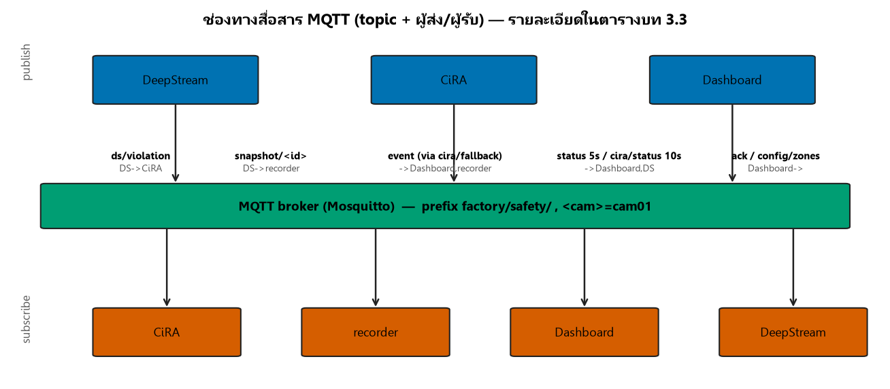
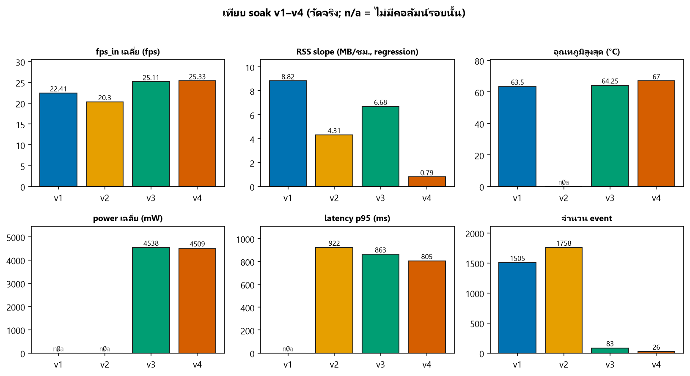

# docs

| ไฟล์ | เนื้อหา |
|---|---|
| [`mqtt_spec.md`](mqtt_spec.md) | สเปก MQTT v3: topic, payload, QoS/retain และกฎ fallback (ข้อตกลงกลางของทุกส่วน) |
| [`design_v3_low_latency.md`](design_v3_low_latency.md) | การออกแบบ v3: แยก Perception (DeepStream) กับ Decision (CiRA), ภาพสดผ่าน WebRTC, เหตุผลที่เลือกกล้อง RTSP |
| [`proposal/`](proposal/) | ข้อเสนอโครงการ |
| [`images/`](images/) | รูปประกอบ README |
| [`test-results/`](test-results/) | สรุปผลทดสอบแต่ละครั้ง (ตารางด้านล่าง) |

## ผลทดสอบ

แต่ละโฟลเดอร์มีเฉพาะไฟล์สรุป (.md) ส่วน log ดิบ, CSV, รูป และวิดีโอไม่ได้ใส่ไว้ใน repo ดังนั้น path ที่อ้างถึงในไฟล์สรุปบางไฟล์จะไม่มีอยู่จริง IP ของเครื่องถูกแทนด้วย `<JETSON_LAN_IP>`, `<JETSON_TAILSCALE_IP>` ฯลฯ

| วันที่ | เรื่อง |
|---|---|
| 2026-10-15 | [สรุปสถานะวันที่ 15 ต.ค.](test-results/2026-10-15_SUMMARY.md) |
| 2026-10-15 | [Benchmark `darknet_` ของ CiRA บน Jetson Nano](test-results/2026-10-15_darknet_bench_jetson/README.md) |
| 2026-10-15 | [Probe กล้อง Tapo C200C ผ่าน RTSP](test-results/2026-10-15_tapo_c200c_probe/README.md) |
| 2026-10-15 | [Baseline DeepStream + YOLOv8n COCO 416×256 FP16 (5W)](test-results/2026-10-15_ds_yolov8n_coco_5W/README.md) |
| 2026-10-15 | [โมเดล PPE 3 คลาสบน DeepStream (5W)](test-results/2026-10-15_ds_ppe3_5W/README.md) |
| 2026-10-15 | [Pipeline กล้องจริงทีละขั้น (5W)](test-results/2026-10-15_ds_cam_stages_5W/README.md) |
| 2026-10-15 | [แอปนับคนบน Jetson Nano](test-results/2026-10-15_person_count_app/README.md) |
| 2026-10-15 | [เทรน PPE 3 คลาสบน Colab](test-results/2026-10-15_train_ppe3_colab/README.md) |
| 2026-10-15 | [A/B คลิป: 1 โมเดล vs 2 โมเดล, COCO 416 vs 320](test-results/2026-10-15_clip_ab/README.md) |
| 2026-10-16 | [ย้าย Docker stack v2 → v3 บน Jetson](test-results/2026-10-16_stack_v3_migration/README.md) |
| 2026-10-16 | [ds/violation + snapshot + fallback event](test-results/2026-10-16_violations/README.md) |
| 2026-10-16 | [ทดสอบกับคลิปตัวอย่าง (ภายในเท่านั้น)](test-results/2026-10-16_yt_clips/README.md) |
| 2026-10-17 | [ทางตัดสินใจผ่าน CiRA CORE แบบ end-to-end](test-results/2026-10-17_cira_decision/README.md) |
| 2026-10-21 | [ตรวจสุขภาพทั้งระบบ](test-results/2026-10-21_health_check/README.md) |
| 2026-10-21 | [CiRA แบบ headless, autostart และปิดพอร์ต](test-results/2026-10-21_som_autostart_ports/README.md) |
| 2026-10-22 | [Soak test รอบ 1](test-results/2026-10-22_soak24h/README.md) |
| 2026-10-22 | Soak test รอบ 2: [วิเคราะห์ fps ตก](test-results/2026-10-22_soak24h_v2/fps_drop_analysis.md), [วินิจฉัยภาพสด WebRTC](test-results/2026-10-22_soak24h_v2/webrtc_diagnosis.md) |
| 2026-10-24 | [แก้ภาพสด WebRTC](test-results/2026-10-24_live_fix/live_fix.md) |
| 2026-10-24 | [Fixes v3](test-results/2026-10-24_fixes_v3/fixes_v3.md) |
| 2026-10-24 | [ทดสอบ autostart หลังรีบูต](test-results/2026-10-24_reboot_test/reboot_test.md) |
| 2026-10-24 | [ตัวเล่นภาพสดของ Dashboard](test-results/2026-10-24_dashboard_live/dashboard_live.md) |
| 2026-10-24 | [Soak test รอบ 3](test-results/2026-10-24_soak24h_v3/README.md) |
| 2026-10-25 | [Fixes v4](test-results/2026-10-25_fixes_v4/fixes_v4.md) |
| 2026-10-26 | [สถาปัตยกรรมโมเดลและชุดข้อมูล](test-results/2026-10-26_model_architecture/README.md) |
| 2026-10-26 | [Soak test รอบ 4 (24 ชม.)](test-results/2026-10-26_soak24h_v4/README.md) |

