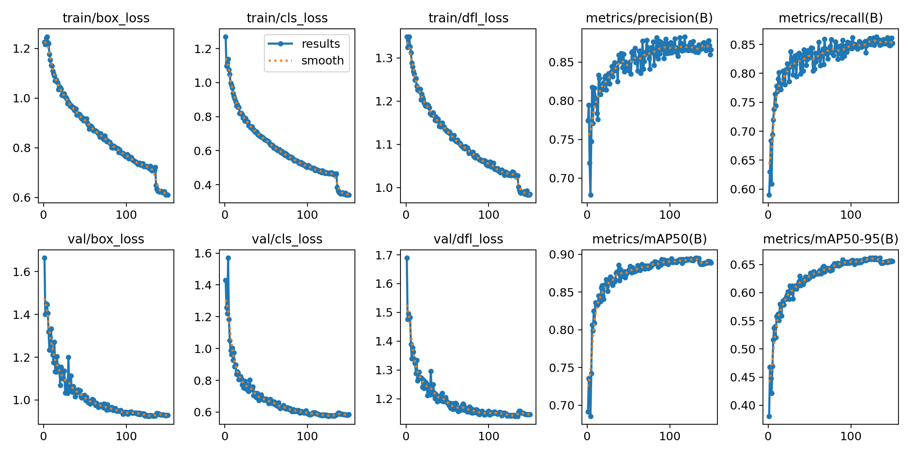

# training: โมเดล ppe3 (person, helmet, vest)

โมเดลตรวจหมวกและเสื้อสะท้อนแสงที่ใช้ใน `perception/` เทรนด้วย Ultralytics บน Google Colab (A100) ภาพและไฟล์ weight ไม่อยู่ใน repo

## ชุดข้อมูล

รวม 4 ชุดจาก Roboflow Universe (ทั้งหมด license CC BY 4.0):

| ชุด | Roboflow project |
|---|---|
| 1 | `flamigos/ppe-wqlb8` |
| 2 | `engtech4ai3group18/ppe-analyser` |
| 3 | `sdp-lfigk/ppe-detection-ozhfb` |
| 4 | `hamdi/person-bm7ow` |

- ชุดที่รวมแล้วมี 7 คลาส (helmet, vest, gloves, goggles, shoes, mask, person) จำนวนภาพ train 4,772 / valid 745 / test 469
- แปลงเหลือ 3 คลาส: person = 0, helmet = 1, vest = 2 และตัด gloves, goggles, shoes, mask ออก
- ภาพพื้นหลังไม่เกิน 10% ของ train, เพิ่มสำเนาภาพขาวดำ 15%, แยกชุดทดสอบภาพขาวดำ, seed 0
- เพิ่ม label คนด้วย pseudo-label จาก YOLOv8x (conf 0.50): 1,859 กรอบใน 1,118 ภาพ
- ชุด train สุดท้าย: 3,082 ภาพ + สำเนาขาวดำ 462 = 3,544 ภาพ (person 3,931, helmet 1,844, vest 2,141 กรอบ)

## การเทรน

- Ultralytics 8.4.177, imgsz 416, epochs 150 (patience 30), batch 32, lr0 0.01, lrf 0.01 (cosine), momentum 0.937, weight decay 0.0005, warmup 3 epoch, close_mosaic 15, AMP
- ค่าทั้งหมดอยู่ใน `results/<โมเดล>/args.yaml` และผลรายรอบใน `results/<โมเดล>/results.csv`
- export เป็น ONNX ขนาด 416×256 (opset 12) ด้วยสคริปต์ของ DeepStream-Yolo commit 2894bab (`perception/export/`)

## ผล (ชุดทดสอบ)

| โมเดล | mAP50 | mAP50-95 | P / R | ภาพขาวดำ mAP50 | ความเร็วบน Jetson (ไฟล์วิดีโอ) |
|---|---|---|---|---|---|
| **YOLOv8n** (ใช้งานจริง) | 0.876 | 0.634 | 0.875 / 0.816 | 0.839 | 47.97 fps |
| YOLO11n | 0.882 | — | 0.830 / 0.858 | 0.842 | 45.45 fps |

เลือก YOLOv8n เพราะเร็วกว่าบน Jetson ขณะที่ความแม่นยำต่างกันไม่ถึง 0.01

ตอนใช้งานจริงแอปใช้ YOLOv8n COCO 320×192 ตรวจคน (เกณฑ์ความมั่นใจ 0.35 ใน `perception/test/config_infer_cam_person_320.txt`) และใช้โมเดลนี้ตรวจเฉพาะหมวก/เสื้อ (helmet 0.40, vest 0.35 ใน `perception/models/yolov8n_ppe3_416/config_infer_yolov8n_ppe3_hv.txt`) (ดู [`docs/test-results/2026-10-26_model_architecture/`](../docs/test-results/2026-10-26_model_architecture/))

## ไฟล์อื่น

- `remap_construction_ppe.py`: สคริปต์จากการทดลองช่วงแรก (แปลงชุดข้อมูล Construction-PPE ของ Ultralytics เป็น 4 คลาส) ไม่ได้ใช้กับโมเดลสุดท้าย

## ข้อจำกัด

- label คนส่วนหนึ่งมาจาก pseudo-label
- ชุดเทรนยังไม่มีภาพจากกล้อง Tapo ในพื้นที่จริง
